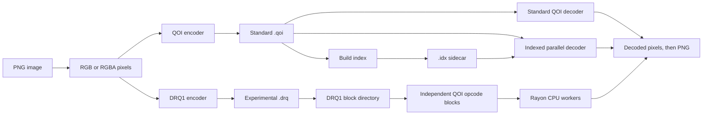

# Drishy

**An experimental Rust QOI codec with CPU-parallel decoding.** Drishy reads and writes standard QOI files and provides an experimental restart-block format, DRQ1, that lets CPU workers decode independent blocks in parallel.

> Use `.qoi` when you need standard QOI compatibility. `.drq` files use DRQ1 and are not readable by ordinary QOI tools.

## What it does

- Encodes PNG images as standard QOI or experimental DRQ1.
- Decodes standard QOI and DRQ1 to PNG.
- Builds an index sidecar so standard QOI files can be decoded in parallel.
- Uses Rayon for CPU parallelism; no GPU is required.
- Includes a Rust library API, correctness tests, fuzz targets, and repeatable benchmarks.

## How decoding works

Standard QOI carries pixel state from one pixel to the next, so a decoder normally processes the stream in order. DRQ1 resets that state at fixed pixel boundaries and stores a length for each block. The decoder can then assign independent blocks to Rayon workers.



The [DRQ1 format description](docs/drq1-format.md) specifies its header, directory, payloads, and block reset state.

## Build and use

Install Rust, then clone and build the project:

```sh
git clone https://github.com/kris70lesgo/drishy.git
cd drishy
cargo build --release
```

Run a command through Cargo with `cargo run --release --`:

```sh
# Standard QOI
cargo run --release -- encode photo.png photo.qoi
cargo run --release -- decode photo.qoi decoded.png

# Experimental restart-block format
cargo run --release -- encode-restart photo.png photo.drq
cargo run --release -- decode-restart photo.drq decoded.png

# Parallel decoding of an existing standard QOI file
cargo run --release -- index photo.qoi photo.qoi.idx
cargo run --release -- decode-indexed photo.qoi photo.qoi.idx decoded.png
```

| Command | Input → output | Purpose |
| --- | --- | --- |
| `encode` | PNG → QOI | Write a standard QOI image. |
| `decode` | QOI → PNG | Decode a standard QOI image. |
| `encode-restart` | PNG → DRQ1 | Encode independent restart blocks. |
| `decode-restart` | DRQ1 → PNG | Decode restart blocks in parallel when the image is large enough. |
| `index` | QOI → `.idx` sidecar | Build checkpoints for parallel decoding. |
| `decode-indexed` | QOI + `.idx` → PNG | Decode a standard QOI image using its index. |

The index sidecar belongs to the QOI file used to create it. Keep the `.qoi` and `.idx` files together.

### Rust API

The library exposes `decode` and `encode` modules for standard QOI, plus `restart_qoi` for DRQ1. For example, `restart_qoi::decode(&bytes)` returns the image header and decoded RGB/RGBA pixel bytes. Callers that reuse an output buffer can use `decode_into`; callers that manage a Rayon pool can use `decode_with_pool` or `decode_into_with_pool`.

### Worker threads

By default, Rayon chooses the process-wide worker pool. Set `RAYON_NUM_THREADS` before launching Drishy to tune it:

```sh
RAYON_NUM_THREADS=8 cargo run --release -- decode-restart photo.drq decoded.png
```

In Windows PowerShell:

```powershell
$env:RAYON_NUM_THREADS = "8"
cargo run --release -- decode-restart photo.drq decoded.png
```

There is no universal best count: the Dell sweep favored 8 threads for fresh-output decoding and 32 for reused-buffer decoding. Measure the workload and machine you care about.

## Benchmarks

Benchmarks compare Drishy with the Rust `qoi` and `rapid-qoi` decoders on the same machine and corpus. Each result below is a median paired speedup from 10 timing samples. The full suite contains 2,848 PNGs and 1,321,975,407 pixels; all runs use 16,384-pixel DRQ1 blocks.

| Machine / Rayon threads | Fresh-output decode vs `qoi` | Reused-buffer decode vs `qoi` | DRQ1 encode vs `qoi` |
| --- | ---: | ---: | ---: |
| Apple M5 / 10 | 3.78× | 4.05× | 1.84× |
| Dell G15 5530 / 8 | 3.27× | 4.39× | 1.73× |
| Dell G15 5530 / 16 | 3.24× | 5.46× | 1.87× |
| Dell G15 5530 / 24 | 3.06× | 6.18× | 1.87× |
| Dell G15 5530 / 32 | 2.91× | 6.33× | 1.87× |

The M5 baseline measured 3.86× over `rapid-qoi` for fresh-output decode. On the Dell, the 8-thread result was 3.19× over `rapid-qoi`; at 32 threads it was 2.84×. Small-image decoding was slower than `qoi` (0.96× on the M5 and about 0.88× on the Dell), while medium and large images drove the speedup. DRQ1 output was about 100.1% of QOI size.

These are codec-throughput measurements on in-memory data. They exclude file reading, PNG conversion, and end-to-end application latency; speedups do not apply to every image. The Dell reports match the reference source commit and corpus fingerprint but mark the working tree as dirty without listing the changed paths, so treat them as supporting cross-computer evidence. See the [M5 report](benchmark-results/drishy-20261124T155944Z.json), [Dell sweep and raw samples](benchmark-results/dell-g15-5530-thread-sweep/), and [benchmark reproduction guide](docs/cross-computer-benchmark.md).

### Run the benchmark

The official QOI benchmark archive is available from [qoiformat.org](https://qoiformat.org/benchmark/qoi_benchmark_suite.tar). It is about 1.1 GB and is not stored in this repository. To create a repeatable full report:

```sh
python3 scripts/repeat_benchmark.py /path/to/qoi_benchmark_suite --runs 2 --threads 10
```

The script saves a JSON summary and a `.samples.jsonl` file under `benchmark-results/`. It records raw timing samples, the source commit and dirty paths, machine and Rust details, worker count, and corpus fingerprint. The timed decode runs in memory; PNG conversion and file I/O happen before timing.

## Development

Run formatting, tests, and Clippy before sending changes:

```sh
cargo fmt --all -- --check
cargo test --locked
cargo clippy --all-targets --locked -- -D warnings
```

The decoder fuzz targets use `cargo-fuzz` and Rust nightly. Seed the targets, then run bounded sessions:

```sh
cargo install cargo-fuzz
mkdir -p fuzz/corpus/qoi_decode fuzz/corpus/restart_decode
cp -R fuzz/seed-corpus/qoi/. fuzz/corpus/qoi_decode/
cp -R fuzz/seed-corpus/restart/. fuzz/corpus/restart_decode/
cargo +nightly fuzz run qoi_decode -- -max_total_time=60
cargo +nightly fuzz run restart_decode -- -max_total_time=60
```

Fuzz inputs and generated images are size-limited to keep runs bounded. These short sessions are useful checks, not proof that every malformed input is safe.
